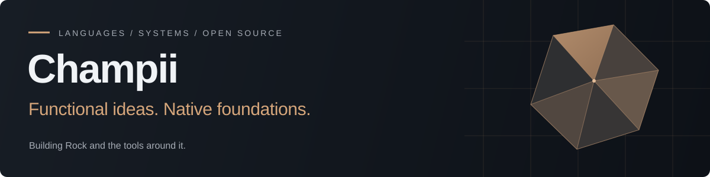
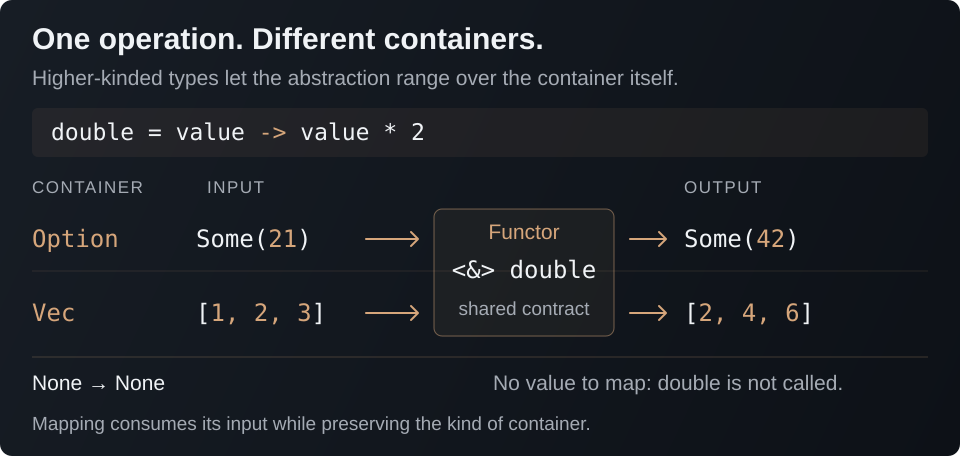
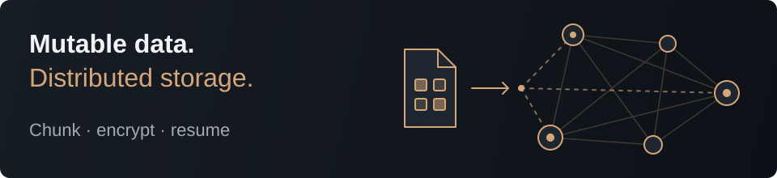
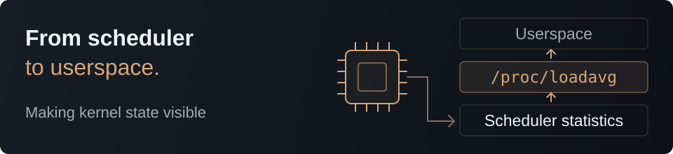

I build **programming languages** and **systems software in Rust**. My work explores how expressive abstractions, explicit ownership, and native execution can fit together — from a language and its compiler to decentralized storage and developer tools.

[Rock](https://github.com/rock-lang-org/rock) · [Language book](https://rock-lang-org.github.io/Rock/) · [Contact](mailto:contact@champii.io)

## Rock — functional programming, native foundations

My main focus: building a language and the ecosystem around it.

[Rock](https://github.com/rock-lang-org/rock) is an experimental, natively compiled language with a **functional style** and **explicit ownership**. Written in Rust and targeting LLVM, it brings together type inference, pattern matching, **higher-kinded types**, and deterministic resource cleanup. Its syntax draws from LiveScript, Haskell, and Rust: concise functions, readable pipelines, and abstractions that compose.

The ambition is to make **functional programming feel natural in systems code**: work with functions and containers at a high level while keeping borrowing, mutation, and resource lifetimes explicit. Traits such as `Functor`, `Monad`, and `Traversable` let different containers share operations; `do` notation makes dependent, fallible steps read as a flat sequence.

### A small example: one operation, different containers



```haskell
double = value -> value * 2

main = !->
    mut values = Vec::new!
    for value in [1, 2, 3]
        values.push value

    Option::Some 21
        <&> double
        |> (.println!)  // Some(42)

    values
        <&> double
        |> (.println!)  // [2, 4, 6]

    Option::None
        <&> double
        |> (.println!)  // None
```

### What I'm building now

#### A more expressive type system

Connecting higher-kinded abstractions, **ownership-aware closures**, and **trait inference** so ordinary programs need fewer annotations; exploring scoped dynamic dispatch and existential packages on a dedicated development branch.

#### A principled compiler–library boundary

Moving **operator meaning and primitive arithmetic policy** into the standard library, backed by explicit compiler intrinsics; extending **UTF-8 text handling** and generic, short-circuiting traversal.

#### A usable language toolchain

Developing `rockup`, the project CLI, **language server**, editor integrations, and the language book alongside the compiler, with **reusable compiled dependency artifacts**.

### The hard problems

The challenge is making these features work together:

- **Ownership across abstractions** — preserving borrowing and cleanup through closures and erased types.
- **Predictable inference** — keeping generic trait calls understandable without excessive annotations.
- **Consistent semantics** — carrying the same guarantees across separately compiled dependencies.

That makes **compiler correctness**, **useful diagnostics**, and realistic library programs central to the work.

Rock is still experimental. The published release and active development branches move at different speeds; the goal is a coherent, usable language, and the current work is about earning that reliability.

**[Explore the compiler →](https://github.com/rock-lang-org/rock)** · [Read the book](https://rock-lang-org.github.io/Rock/) · [Try a release](https://github.com/rock-lang-org/rock/releases) · [Join the discussion](https://discord.gg/f6skPNB96J)

## Selected projects

### [Rock ecosystem](https://github.com/rock-lang-org) · Taking the language beyond the compiler

I'm building the surrounding tools and libraries that let Rock be used for real programs. [rock_http](https://github.com/rock-lang-org/rock_http) is a **blocking HTTP/1.1 server library written in Rock**, with bounded request parsing, response framing, and a thread-per-connection model built on safe standard-library APIs. It gives the language a concrete systems workload.

[rock.nvim](https://github.com/rock-lang-org/rock.nvim), [vscode-rock](https://github.com/rock-lang-org/vscode-rock), and [tree-sitter-rock](https://github.com/rock-lang-org/tree-sitter-rock) bring the **editing experience** along with it.

### [Mutant](https://github.com/champii/Mutant) · Mutable storage on a decentralized network



A Rust storage system that turns the Autonomi network into a **mutable key–value interface**. Mutant combines encrypted private storage and public sharing with **chunked, resumable uploads**, storage-pad reuse, and synchronization.

A persistent daemon manages network operations and background tasks, exposed through an async Rust API, a CLI, and a web workspace with file viewing, editing, and media streaming. The underlying problem: making distributed storage practical when transfers are interrupted, data changes, and network operations take time.

### [Asterinas](https://github.com/asterinas/asterinas) · Kernel development in Rust



My kernel work includes contributing **load-average accounting** and the corresponding `/proc/loadavg` interface to Asterinas, a Rust operating-system kernel with a **Linux-compatible ABI**. The implementation connects scheduler statistics to the proc filesystem, using fixed-point arithmetic and lazy calculation of load averages.

It's systems work at a different layer: turning internal scheduling state into useful information for userspace while respecting kernel constraints. [View the contribution →](https://github.com/asterinas/asterinas/commit/4701eaf0cb2dcf8f8bd668e4d9ef6f1d64d6fca3)

Earlier explorations include [Comet](https://github.com/champii/Comet), a reactive, isomorphic full-stack framework for Rust, and [reactive-postgres-rs](https://github.com/champii/reactive-postgres-rs), a reactive layer over PostgreSQL.

## GitHub, in numbers

<p>
  <picture>
    <source media="(prefers-color-scheme: dark)" srcset="https://github-readme-stats.vercel.app/api?username=champii&amp;show_icons=true&amp;include_all_commits=true&amp;hide_rank=true&amp;card_width=400&amp;hide_border=true&amp;bg_color=0d1117&amp;title_color=d6a67b&amp;icon_color=d6a67b&amp;text_color=c9d1d9" />
    
  </picture>
  <picture>
    <source media="(prefers-color-scheme: dark)" srcset="https://github-readme-streak-stats.herokuapp.com/?user=champii&amp;hide_border=true&amp;background=0D1117&amp;ring=D6A67B&amp;fire=D6A67B&amp;currStreakLabel=D6A67B&amp;sideLabels=C9D1D9&amp;currStreakNum=C9D1D9&amp;sideNums=C9D1D9&amp;dates=8B949E&amp;stroke=30363D" />
    
  </picture>
</p>

---

Interested in language design, compilers, or decentralized systems? **[Let's talk.](mailto:contact@champii.io)**
